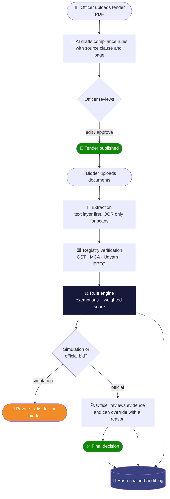
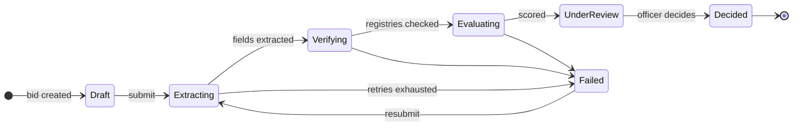
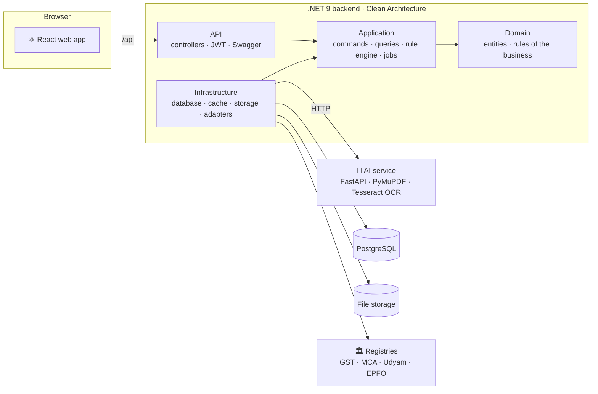

<div align="center">

# 🛡️ BidGuard AI

### Smarter compliance. Stronger bids.

**Explainable bid compliance verification for GeM procurement**

Smart India Hackathon 2026 · Problem Statement **SIH26100** · Team **Innoverse**


</div>

---

## 📌 The problem

Every GeM tender has its own eligibility, technical and financial conditions, written as free text inside a PDF. For each bid, a procurement officer has to open dozens of certificates and financial papers, find the right values, match them with the tender, and confirm the registrations are genuine.

| Pain point | What happens today |
|---|---|
| 🐢 **Slow** | Evaluation takes days per tender and gets worse with every extra bidder |
| 🎲 **Inconsistent** | Two officers can read the same clause differently |
| ⚠️ **Error-prone** | Expired certificates, mismatched GSTINs and missed exemptions slip through |
| 🙈 **Opaque to bidders** | MSMEs learn about a rejection only after the bid closes, often for a five-minute fix |

## 💡 The idea

BidGuard AI rests on three ideas.

| | Idea | What it means |
|---|---|---|
| 1️⃣ | **Compliance-as-Code** | Each tender clause becomes a small machine-readable rule, so the platform adapts to any tender without code changes |
| 2️⃣ | **AI assists, rules decide** | AI only drafts rules and reads documents. A deterministic rule engine gives the verdict, and the officer makes the final call |
| 3️⃣ | **Check before you bid** | Bidders test their documents privately first and get a ranked list of what to fix |

---

## 🔄 How it works



### Step by step

| # | Step | Who | What happens |
|---|---|---|---|
| 1 | **Tender → rules** | Officer | Uploads the tender PDF. The AI service drafts one rule per requirement, with the clause and page it came from |
| 2 | **Review and publish** | Officer | Edits, approves or deletes each draft, adds rules by hand if needed, then publishes. Rules are locked after publishing |
| 3 | **Upload** | Bidder | Uploads certificates and financial papers (PDF or image) and submits |
| 4 | **Extraction** | System | Reads GSTIN, PAN, Udyam, CIN, turnover, experience, ISO details, and remembers the page and position of each value |
| 5 | **Verification** | System | Checks identifiers with the registries and flags a mismatch when a document disagrees with the bidder's profile |
| 6 | **Evaluation** | System | Applies exemptions, evaluates every rule, and produces a score out of 100 with a suggested decision |
| 7 | **Review** | Officer | Sees each verdict with its proof, opens the exact page with the value highlighted, overrides with a reason if needed |
| 8 | **Decision** | Officer | Records the final decision. The bidder is notified |

### What happens to a bid



Uploads return immediately. Background jobs carry the bid through each stage, and the bidder sees live progress on screen.

---

## 👥 Who uses it

| Role | What they can do |
|---|---|
| 👩‍💼 **Procurement officer** | Create tenders, upload the PDF, review AI-drafted rules, publish, review bids with evidence, override, decide, view the dashboard and audit log |
| 🏢 **Bidder** | Browse open tenders and their requirements, run private simulations, submit an official bid, track progress, manage the organization profile and credential wallet |
| 🔑 **Admin** | Everything an officer can do, plus create officer and admin accounts |

> The login page has one-click demo roles, so you can try all three without creating accounts.

---

## ✨ Features

<table>
<tr>
<td width="50%" valign="top">

### For officers
- 🤖 AI-drafted rules, approved by a human
- ✏️ Rule editor with a plain-language preview
- 📊 Per-rule verdict with explanation and evidence
- 🔎 Evidence viewer that highlights the value on the original page
- 🖊️ Override with a mandatory reason and automatic re-scoring
- 📈 Dashboard: bids by outcome, most-failed requirements
- 🔗 Tamper-evident audit log with one-click verification

</td>
<td width="50%" valign="top">

### For bidders
- 🧪 Private pre-bid simulator (officers never see it)
- 🛠️ Ranked fix list with the score each fix adds
- 💼 Credential wallet
- ⏰ Expiry alerts 30 days before a certificate lapses
- 📡 Live progress through every processing stage
- 🔔 Notifications when a bid is evaluated or decided

</td>
</tr>
</table>

### Policy awareness

| Relaxation | Applies to | Condition |
|---|---|---|
| **EMD exemption** | Micro and Small Enterprises | Udyam registration verified with the registry |
| **EMD exemption** | Startups | DPIIT recognised |
| **Prior experience / turnover relaxation** | Startups | DPIIT recognised, on rules marked eligible |

The reason for every exemption is recorded with the verdict.

---

## 🧩 Compliance-as-Code

A tender clause such as *"Minimum average annual turnover during the last three years should be Rs. 50 Lakh"* becomes:

```json
{ "field": "turnover.avg3y", "op": ">=", "value": 5000000 }
```

Rules can be combined:

```json
{
  "all": [
    { "field": "gstin", "op": "exists" },
    { "field": "gstin", "op": "verified", "source": "GST" },
    { "field": "iso9001.expiry", "op": "after", "value": "$bidEndDate" }
  ]
}
```

| Part | Options |
|---|---|
| **Operators** | `exists` `==` `!=` `>=` `<=` `>` `<` `in` `before` `after` `verified` |
| **Combinators** | `all` `any` `not` |
| **Outcomes** | ✅ Pass · ❌ Fail · ❓ Missing · 🛡️ Exempted |
| **Tender variables** | `$bidEndDate` `$estimatedValue` `$emdAmount` |

**Scoring:** score = weighted share of rules that passed or were exempted. Any mandatory **Fail** → Non-compliant. Otherwise any mandatory **Missing** → Needs clarification. Otherwise → Compliant.

Every verdict comes with a plain explanation, for example: `experience.years is 2; required >= 3`.

---

## 🏗️ Architecture



Dependencies point inward: the API and Infrastructure depend on Application, Application depends on Domain, and Domain depends on nothing. Every outside system sits behind an interface, so the simulated registries can be replaced with real government APIs without touching business logic.

### Project structure

```
backend/
  src/BidGuard.Domain            Entities with guarded state changes, enums, repository interfaces
  src/BidGuard.Application       Features/Commands and Features/Queries per category, validators,
                                 rule engine, exemptions, scoring, audit, background job classes
  src/BidGuard.Infrastructure    EF Core + PostgreSQL, repositories, JWT + refresh tokens, cache,
                                 file storage, AI service client, registry adapters, Hangfire
  src/BidGuard.API               Thin controllers, authentication, Swagger, error handling
  tests/                         xUnit tests
bidguard-ai/                     AI service: text extraction, OCR, rule and entity extraction
frontend/                        React web app
deploy/                          Single-image Dockerfile and deployment guide
samples/                         Sample tender and bid PDFs
scripts/                         End-to-end demo script
```

### Tech stack

| Layer | Technology |
|---|---|
| **Web app** | React 19, TypeScript, Vite, Tailwind CSS, TanStack Query, pdf.js |
| **API** | .NET 9, ASP.NET Core, Mediator + CQRS, FluentValidation |
| **Data** | PostgreSQL, Entity Framework Core (Fluent API per entity) |
| **Auth** | JWT with `user_id`, `email`, `role` claims, rotating refresh tokens, BCrypt |
| **Background jobs** | Hangfire |
| **Cache** | Redis (falls back to in-memory) |
| **Files** | S3-compatible storage or a local volume |
| **AI service** | Python, FastAPI, PyMuPDF, Tesseract OCR, optional LLM with offline fallback |
| **Packaging** | Docker, Docker Compose, nginx |

---

## 🔒 Security and trust

| Area | How it is handled |
|---|---|
| **Sessions** | Short-lived access tokens plus refresh tokens that rotate on every use. Reusing an old refresh token revokes all sessions of that user |
| **Roles** | Admin, Officer, Bidder. Bidders only see their own organization's bids; officers never see simulations |
| **Audit** | Every action is appended to a log where each entry stores the SHA-256 hash of the previous one. Changing any past entry breaks the chain, and the verify button finds the first broken entry |
| **Decisions** | AI never issues a verdict. Overrides need a written reason and are logged |
| **Uploads** | Type and size checks, files stored outside the database with a SHA-256 fingerprint |

---

## 🚀 Run it

**Requirement:** Docker Desktop.

```bash
docker compose up -d --build
```

| Open | What you get |
|---|---|
| http://localhost:3000 | 🌐 The web app |
| http://localhost:8080/swagger | 📘 API documentation |
| http://localhost:8080/hangfire | ⚙️ Background jobs dashboard |

### Try the demo in two minutes

1. Open the web app and click **Officer**, then **Sign in**.
2. **Tenders → New tender**, fill in the form, then upload `samples/tender_sample.pdf`.
3. Wait a few seconds for the AI-drafted rules, click **Approve all**, then **Publish tender**.
4. Sign out, click **Bidder**, then **Sign in**.
5. **Open tenders →** your tender **→ Run pre-bid simulation**, upload `samples/bid_noncompliant.pdf`, and run it. You get a score and a fix list.
6. Go back, **Start official bid**, upload `samples/bid_compliant.pdf`, and submit.
7. Sign in as **Officer** again, open the tender, and **Review** the bid: verdicts, evidence, registry checks, decision.
8. **Audit log → Verify chain**.

Or run the whole flow from the command line:

```powershell
powershell -ExecutionPolicy Bypass -File scripts/smoke.ps1
```

### What the demo shows

| Bid | Score | Result |
|---|---|---|
| Weak documents (simulation) | **20 / 100** | Non-compliant, with 4 fixes: turnover +30, experience +20, ISO renewal +20, OEM letter +10 |
| Complete documents (official) | **100 / 100** | Compliant, EMD exempted for a verified MSE, all 4 registry checks passed |

### Deploying

The whole application also ships as a single image that needs only a PostgreSQL database. See [`deploy/DEPLOY.md`](deploy/DEPLOY.md).

---

## 🧪 Tests

```bash
# Backend
dotnet test backend/BidGuard.sln

# AI service
cd bidguard-ai && python -m venv .venv && .venv/Scripts/pip install -r requirements-dev.txt && .venv/Scripts/python -m pytest

# Web app
cd frontend && npm ci && npm test
```

The backend suite covers the rule engine, exemptions, scoring, audit chain, authentication, the bid pipeline and access rules. The AI service suite covers amount and date parsing, entity extraction and rule drafting.

---

## 🧭 Current limits and what is next

**Limits of this prototype**
- Government registries are simulated behind adapters.
- Value highlighting works on digital PDFs; values read by OCR have no exact position.
- Rule drafting has been tested on sample tenders, not a large real corpus.

**Planned**
- 🧐 **Tender Fairness Linter**: check the tender itself for restrictive or non-compliant clauses before publishing
- 📑 **Corrigendum handling**: when a tender is amended, re-evaluate only the affected bids
- 🇮🇳 **Make in India**: local content and purchase preference checks
- 💬 **Clarification workflow** between officer and bidder

---

<div align="center">

**Team Innoverse** · Smart India Hackathon 2026

</div>
